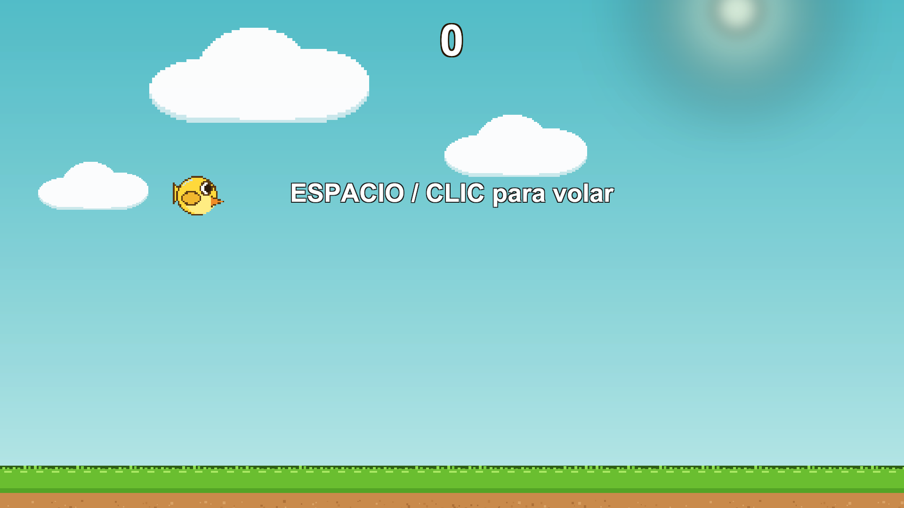
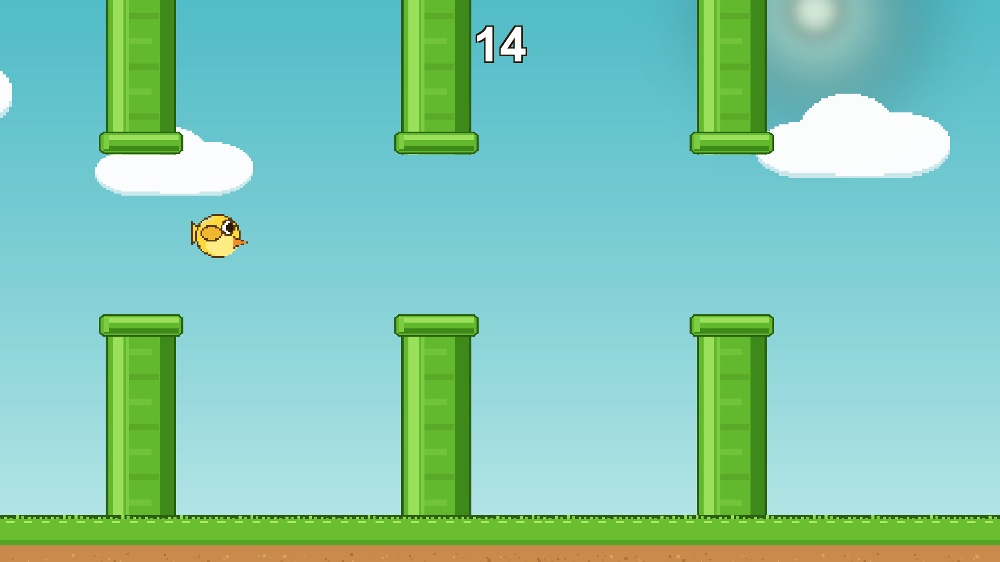
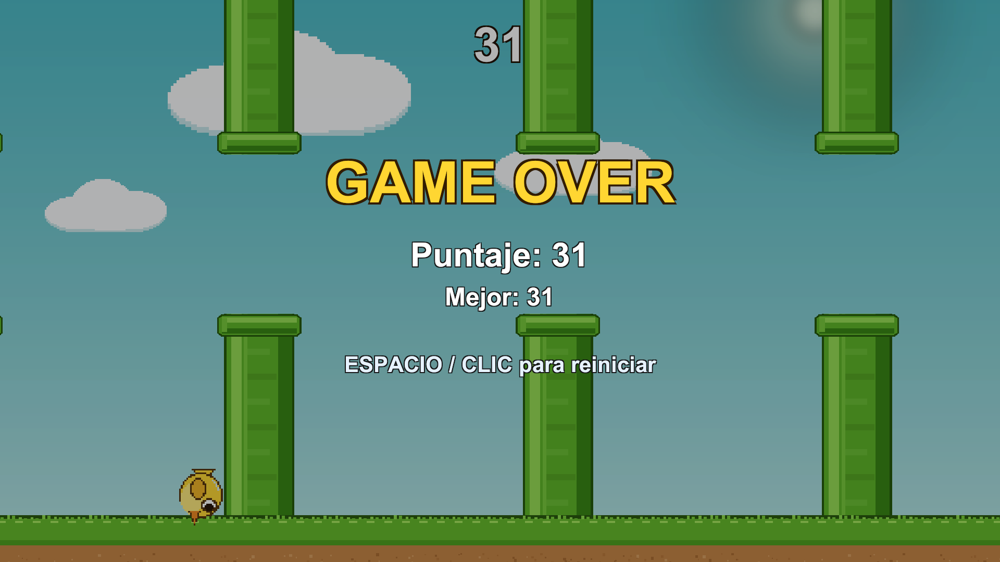

# Flappy Bird — Unity 6 + MCP

Versión simple de Flappy Bird hecha en **Unity 6** como práctica de control de
versiones y del flujo de trabajo con **MCP for Unity**.



## Controles

| Acción | Teclado | Mouse / táctil | Gamepad |
| --- | --- | --- | --- |
| Aletear / empezar | `Espacio` o `Enter` | Clic izquierdo / toque | Botón A (sur) |

Al morir se muestra el panel de **Game Over** con el puntaje de la partida y el
mejor puntaje guardado. Después de 0,75 s se puede reiniciar con la misma tecla.

## Cómo ejecutar el proyecto

1. Abrir el proyecto con **Unity 6000.6.0f1** (Unity 6.6).
2. Abrir la escena `Assets/Scenes/FlappyBird.unity`.
3. Presionar **Play**.

La escena ya está registrada en **Build Settings** como única escena de la
build. El proyecto usa el **Input System** nuevo (`activeInputHandler: 1`), por
lo que no es necesario cambiar nada en *Project Settings > Player*.



## Características

- Estados de juego: `Ready`, `Playing` y `GameOver`.
- Puntaje en pantalla y récord persistente con `PlayerPrefs`.
- Tuberías con hueco aleatorio, movimiento continuo y reciclado fuera de cámara.
- Suelo infinito con tres segmentos que se reciclan sin cortes.
- Nubes con desplazamiento parallax.
- Animación de aleteo y rotación del pájaro según su velocidad vertical.
- Muerte por colisión con tuberías o con el suelo.
- Efectos de sonido sintetizados en tiempo de ejecución (sin archivos de audio).
- HUD construido por código con uGUI y la fuente integrada `LegacyRuntime.ttf`.
- Arte pixel art generado con un script de Python; no se usan assets externos.



## Estructura

```text
Assets/
  FlappyBird/
    Scripts/        Lógica del juego (input, estados, pájaro, tuberías, UI…)
    Prefabs/        PipePair.prefab
    Sprites/        Fondo, nubes, tuberías y suelo
    Resources/
      BirdFrames/   Fotogramas de la animación del pájaro
  Scenes/
    FlappyBird.unity
Docs/
  screenshots/      Capturas usadas en este README
Tools/
  generate_art.py   Generador del arte pixel art (Pillow)
```

## MCP for Unity

El proyecto está preparado para trabajar con **MCP for Unity**:

- El paquete está declarado en `Packages/manifest.json`:
  `com.coplaydev.unity-mcp` (repositorio oficial de CoplayDev).
- El servidor MCP se ejecuta en `http://127.0.0.1:8080/mcp`.
- La escena, el prefab, los sprites (import settings), los scripts y la
  configuración de build se crearon/ajustaron mediante las herramientas MCP
  (`manage_scene`, `manage_gameobject`, `manage_prefabs`, `manage_texture`,
  `manage_build`, `execute_code`, etc.).

Para usarlo, abrir la ventana **Window > MCP For Unity** en el editor y
conectar el cliente MCP al servidor local.

## Arte

Los sprites se generan con:

```bash
python Tools/generate_art.py
```

Requiere **Python 3** y **Pillow**. El script escribe los PNG en
`Assets/FlappyBird/Sprites` y en `Assets/FlappyBird/Resources/BirdFrames`.

## Créditos

Proyecto académico de **adircracknew26** para la práctica de manejo de
repositorios y MCP. Flappy Bird es una idea original de Dong Nguyen; este
proyecto es una recreación educativa sin fines comerciales.
